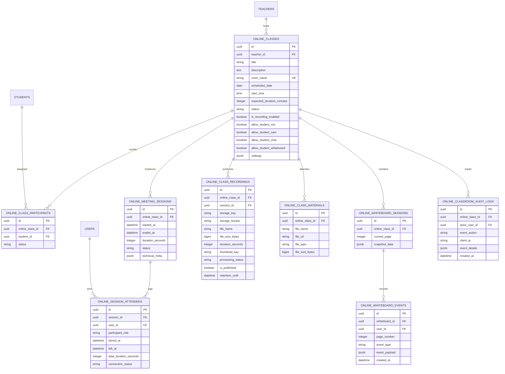

# Online Classroom: Database Design & Schema Specifications

## 1. Design Principles & Isolation
1. **Zero Coupling to Operational Modules**:
   - No foreign keys referencing `attendances`, `timetables`, `examinations`, or `invoices`.
   - References core identity tables only: `teachers.id`, `students.id`, and `users.id`.
2. **PostgreSQL / SQLAlchemy Declarative Models**:
   - Follows project convention: inherits from `Base` and `TimestampMixin` (`created_at`, `updated_at`).
   - Uses UUIDv4 primary keys.
3. **Audit & Traceability**:
   - Tracks session durations, join/leave timestamps, participant roles, and event history.

---

## 2. Entity Relationship Diagram (ERD)

---

## 3. Database Schema Definitions (SQLAlchemy 2.0 / Pydantic Style)

### 3.1 `online_classes`
Stores the master definition and scheduling parameters for an online class.
- `id` (UUID, Primary Key)
- `teacher_id` (UUID, Foreign Key -> `teachers.id`, Index)
- `title` (VARCHAR(200), Not Null)
- `description` (TEXT, Nullable)
- `room_name` (VARCHAR(100), Unique, Not Null, Index) - E.g. `cls-a4f89d...`
- `scheduled_date` (DATE, Not Null, Index)
- `start_time` (TIME, Not Null)
- `expected_duration_minutes` (INTEGER, Default 60)
- `status` (VARCHAR(30), Default 'SCHEDULED', Index) - Values: `SCHEDULED`, `LIVE`, `COMPLETED`, `CANCELLED`
- `is_recording_enabled` (BOOLEAN, Default False)
- `allow_student_mic` (BOOLEAN, Default True)
- `allow_student_cam` (BOOLEAN, Default True)
- `allow_student_chat` (BOOLEAN, Default True)
- `allow_student_whiteboard` (BOOLEAN, Default False)
- `settings` (JSONB, Default `{}`)
- `created_at` / `updated_at` (TIMESTAMPTZ)

### 3.2 `online_class_participants`
Defines explicitly authorized students for a class.
- `id` (UUID, Primary Key)
- `online_class_id` (UUID, Foreign Key -> `online_classes.id`, Index, On Delete CASCADE)
- `student_id` (UUID, Foreign Key -> `students.id`, Index, On Delete CASCADE)
- `status` (VARCHAR(20), Default 'ACTIVE') - Values: `ACTIVE`, `REMOVED`
- Unique Constraint: `(online_class_id, student_id)`

### 3.3 `online_meeting_sessions`
Records actual live runtime execution instances of a classroom.
- `id` (UUID, Primary Key)
- `online_class_id` (UUID, Foreign Key -> `online_classes.id`, Index)
- `started_at` (TIMESTAMPTZ, Not Null)
- `ended_at` (TIMESTAMPTZ, Nullable)
- `duration_seconds` (INTEGER, Default 0)
- `status` (VARCHAR(20), Default 'ACTIVE') - Values: `ACTIVE`, `ENDED`, `DISCONNECTED`
- `technical_meta` (JSONB, Default `{}`) - WebRTC room SID, egress ID, server region.

### 3.4 `online_session_attendees`
Tracks student, teacher, and observer join/leave intervals.
- `id` (UUID, Primary Key)
- `session_id` (UUID, Foreign Key -> `online_meeting_sessions.id`, Index, On Delete CASCADE)
- `user_id` (UUID, Foreign Key -> `users.id`, Index)
- `participant_role` (VARCHAR(20), Not Null) - Values: `TEACHER`, `STUDENT`, `ADMIN_OBSERVER`
- `joined_at` (TIMESTAMPTZ, Not Null)
- `left_at` (TIMESTAMPTZ, Nullable)
- `total_duration_seconds` (INTEGER, Default 0)
- `connection_status` (VARCHAR(20), Default 'CONNECTED')

### 3.5 `online_class_recordings`
Stores recording metadata and object storage references.
- `id` (UUID, Primary Key)
- `online_class_id` (UUID, Foreign Key -> `online_classes.id`, Index)
- `session_id` (UUID, Foreign Key -> `online_meeting_sessions.id`, Nullable, Index)
- `storage_key` (VARCHAR(500), Not Null) - Path in S3 bucket
- `storage_bucket` (VARCHAR(100), Not Null)
- `file_name` (VARCHAR(255), Not Null)
- `file_size_bytes` (BIGINT, Default 0)
- `duration_seconds` (INTEGER, Default 0)
- `thumbnail_key` (VARCHAR(500), Nullable)
- `processing_status` (VARCHAR(30), Default 'PROCESSING') - Values: `PROCESSING`, `AVAILABLE`, `FAILED`, `ARCHIVED`
- `is_published` (BOOLEAN, Default True)
- `retention_until` (TIMESTAMPTZ, Nullable)

### 3.6 `online_class_materials`
Learning materials and presentation documents uploaded for the class.
- `id` (UUID, Primary Key)
- `online_class_id` (UUID, Foreign Key -> `online_classes.id`, Index, On Delete CASCADE)
- `file_name` (VARCHAR(255), Not Null)
- `file_url` (VARCHAR(1000), Not Null)
- `file_type` (VARCHAR(100), Not Null)
- `file_size_bytes` (BIGINT, Default 0)

### 3.7 `online_whiteboard_sessions` & `online_whiteboard_events`
Persists whiteboard state and drawing history for replay/restoration.
- `online_whiteboard_sessions`: `id`, `online_class_id`, `current_page`, `snapshot_data` (JSONB)
- `online_whiteboard_events`: `id`, `whiteboard_id`, `user_id`, `page_number`, `event_type` (`DRAW`, `CLEAR`, `SHAPE`, `TEXT`), `event_payload` (JSONB), `created_at`

### 3.8 `online_classroom_audit_logs`
Provides compliance and forensic tracking for administrative review.
- `id` (UUID, Primary Key)
- `online_class_id` (UUID, Foreign Key -> `online_classes.id`, Index)
- `actor_user_id` (UUID, Foreign Key -> `users.id`, Index)
- `event_action` (VARCHAR(50), Not Null) - E.g. `MUTED_STUDENT`, `REMOVED_STUDENT`, `ADMIN_OBSERVER_JOINED`, `RECORDING_STARTED`
- `client_ip` (VARCHAR(50), Nullable)
- `event_details` (JSONB, Default `{}`)

---

## 4. Alembic Migration Strategy
1. **Non-destructive Migration**:
   - The migration file (`alembic/versions/xxxx_create_online_classroom_tables.py`) will contain ONLY `op.create_table` operations and associated indexes.
   - Zero modifications, columns, or triggers will be added to existing tables (`users`, `teachers`, `students`, `classes`, etc.).
2. **Rollback Safety**:
   - `downgrade()` strictly drops the newly created online classroom tables in reverse dependency order.
