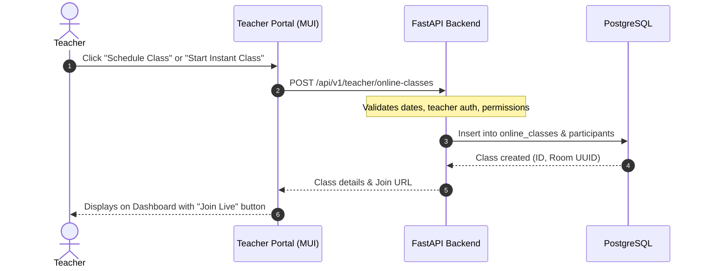
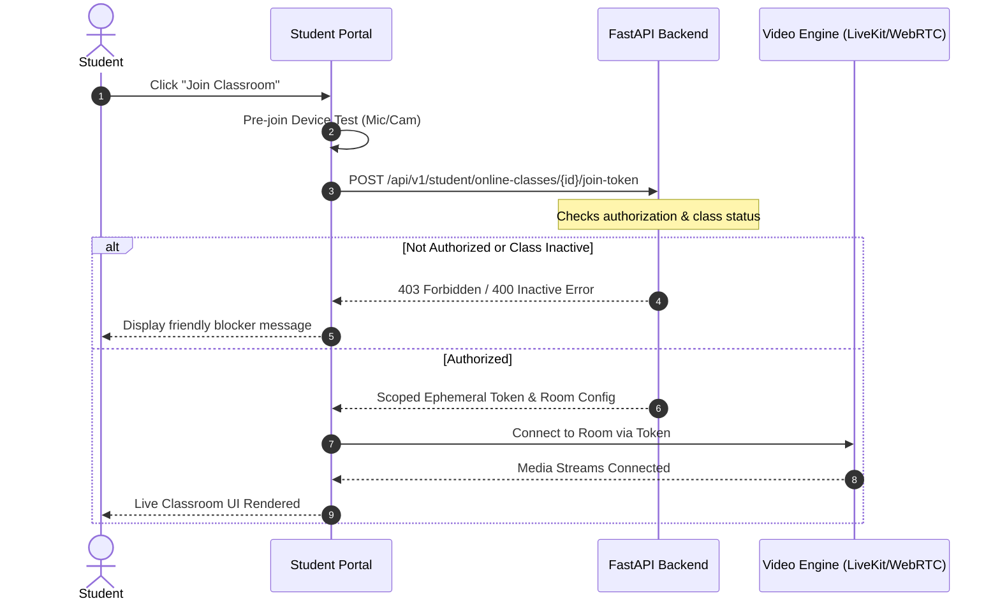

# Online Classroom & Virtual Learning Module: Feature Specification

## 1. Overview and Objectives
The **Online Classroom & Virtual Learning Module** delivers a Google Meet-like, real-time virtual classroom experience directly integrated into the Student Management System. It enables teachers to schedule and conduct live interactive classes, students to join and collaborate in a secure learning environment, and school administrators to monitor live operations, track participation, and oversee session recordings.

### 1.1 Core Principles & Module Independence
- **Strict Independence**: The module functions completely autonomously. It does not couple with or depend on the existing timetable, attendance system, examination schedules, fee modules, or academic calendar.
- **Zero Automatic Attendance**: Joining an online classroom does not automatically mark attendance in the traditional attendance tables. Meeting presence is logged exclusively within the online classroom's own session history.
- **Unified Identity**: Leverages existing authenticated `User`, `Teacher`, and `Student` accounts without modifying existing authentication models or session tables.
- **Enterprise Security**: Room tokens are time-limited, signed, and scoped to verified participants.

---

## 2. User Roles & Capabilities

### 2.1 Teacher Role
1. **Online Classroom Dashboard**:
   - High-level overview: upcoming classes, live classes in progress, completed classes, recorded sessions.
   - Class metrics: participant counts, scheduled start/end, expected duration, and recording statuses.
   - Actions: "Start Instant Class", "Schedule Class", "Edit Details", "Cancel Class".
2. **Class Scheduling**:
   - Attributes: Title, description, scheduled date, start time, expected duration.
   - Participant Selection: Select specific students independently (e.g., multi-select search or cohort tags) without depending on existing timetable constraints.
   - Attachments: Upload lesson slides, PDFs, reference links.
   - Meeting Permissions & Guardrails:
     - Allow student microphones (Enabled/Disabled).
     - Allow student webcams (Enabled/Disabled).
     - Allow in-meeting chat (Enabled/Disabled).
     - Allow student whiteboard collaboration (Enabled/Disabled).
     - Enable automatic/manual recording (Enabled/Disabled).
3. **Live Classroom Interface (Google Meet Experience)**:
   - Media controls: Toggle camera, microphone, device selector (mic, camera, speaker).
   - Screen Sharing: Full screen, window, or specific browser tab.
   - Video Grid: Adaptive grid layout with active speaker highlighting and teacher spotlight.
   - Participant Management: View roster, connection quality indicator, mute individual students, mute all, and remove disruptive participants.
   - In-class Chat: Public classroom messaging with timestamp and sender identification.
   - Collaborative Whiteboard: Multi-tool digital canvas with teacher-controlled student write permissions.
   - Recording Controls: Start, pause, resume, and stop recording with visible on-screen status.

### 2.2 Student Role
1. **Student Classroom Dashboard**:
   - Organized tabs: Upcoming Classes, Ongoing Live Classes, Past Sessions, Recording Library.
   - Class Cards: Subject/title, teacher name, date & time, description, attached learning materials, and live join status.
2. **Pre-Join Screen (Green Room)**:
   - Camera and microphone preview and device testing.
   - Audio input level meter.
   - Join button disabled if class has not started or student is unauthorized.
3. **Live Classroom Participation**:
   - View teacher video stream, shared screen, or active speaker.
   - Toggle own camera and microphone (subject to teacher permissions).
   - Interactive Whiteboard view (and real-time drawing when permitted).
   - In-class chat communication (when enabled).
   - Hand Raise feature to request teacher attention.
   - Clean "Leave Class" action.
4. **Recording Library**:
   - Access recordings of authorized classes with video playback, scrubbing, duration, and speed controls (0.75x to 2x).
   - Watermarked and protected streaming (no public or unauthenticated links).

### 2.3 Administrator Role
1. **Admin Monitoring Dashboard**:
   - Macro KPIs: Total scheduled classes, active ongoing classes, completed classes, total student participants, total active teachers, and storage utilized for recordings.
2. **Live Classroom Oversight**:
   - Real-time directory of all live classes.
   - Session metadata: Teacher, start time, elapsed duration, participant count, recording state.
   - Authorized Observer Mode: Administrator can join an ongoing class as an explicit observer with a visible banner and notification ("Administrator has joined as an observer") to prevent covert surveillance.
3. **Recording & Retention Management**:
   - Central repository of all recorded classes across the institution.
   - Filtering by teacher, date range, status, and size.
   - Storage usage tracking, export capabilities, and retention policy controls.

---

## 3. Detailed Functional Workflows

### 3.1 Teacher Scheduling & Instant Launch Flow

### 3.2 Student Join & Verification Flow

---

## 4. Non-Functional Requirements
- **Latency**: Sub-300ms glass-to-glass audio/video latency.
- **Scalability**: Capable of handling up to 100 concurrent students per classroom and 50 concurrent active classes.
- **Responsiveness**: Fully responsive across Desktop (1920x1080, 1366x768), Tablet (iPad/Android 768px), and Mobile devices (375px+).
- **Accessibility**: WCAG 2.2 AA compliant, keyboard accessible controls, high-contrast indicators, and ARIA labels.
- **Resilience**: Auto-reconnect with exponential backoff on transient network drops without terminating the user's meeting state.
