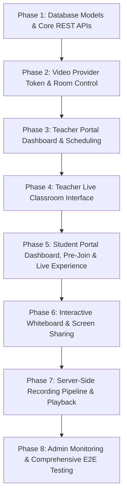

# Online Classroom: Phased Implementation Plan

## 1. Overview
The implementation is structured into 8 modular, independently verifiable phases. Each phase culminates in automated tests and verification before moving to the next.

---

## 2. Phase Breakdown

### Phase 1: Database Models, Alembic Migration & Core REST APIs
- **Tasks**:
  1. Create SQLAlchemy models in `app/models/online_classroom.py` (`OnlineClass`, `OnlineClassParticipant`, `OnlineMeetingSession`, `OnlineSessionAttendee`, `OnlineClassRecording`, `OnlineClassMaterial`, `OnlineWhiteboardSession`, `OnlineClassroomAuditLog`).
  2. Generate and apply non-destructive Alembic migration (`alembic/versions/xxxx_create_online_classroom_tables.py`).
  3. Implement Pydantic schemas in `app/schemas/online_classroom.py`.
  4. Implement service layer in `app/services/online_classroom_service.py`.
  5. Expose REST endpoints for class CRUD, participant assignments, and session lifecycle.
- **Verification**: Pytest unit tests for all CRUD operations, participant validations, and migration rollback.

### Phase 2: Video Engine Integration (LiveKit Client/Server) & WebSockets
- **Tasks**:
  1. Add `livekit-api` package to backend dependencies.
  2. Implement `LiveKitTokenService` to issue cryptographically signed, role-scoped access tokens.
  3. Implement FastAPI WebSocket endpoint (`/api/v1/online-classes/{id}/ws`) for whiteboard and in-room chat message fanout.
  4. Implement webhook receiver (`/api/v1/online-classes/webhooks/livekit`) for automated room start/end and attendee tracking.
- **Verification**: Unit tests for token generation, signature validation, and WebSocket broadcast tests.

### Phase 3: Teacher Portal - Dashboard & Class Scheduling UI
- **Tasks**:
  1. Add navigation link in `frontend/admin-frontend/src/components/layout/AppShell.tsx` for `TEACHER` role.
  2. Create feature directory `frontend/admin-frontend/src/features/online-classroom/`.
  3. Build Teacher Dashboard: Metric cards, tabbed class list (Upcoming, Live, Completed, Recordings).
  4. Build "Schedule Online Class" Dialog with independent student search/multi-select and permission toggles.
  5. Build "Start Instant Class" workflow.
- **Verification**: Vitest unit tests for Teacher Dashboard and Schedule dialog components.

### Phase 4: Teacher Portal - Google Meet-Style Live Classroom
- **Tasks**:
  1. Create dedicated full-screen live meeting route `frontend/admin-frontend/src/app/online-classroom/[id]/live/page.tsx`.
  2. Implement video grid with speaker spotlight and active audio indicators.
  3. Implement bottom action bar (Mic, Camera, Screen Share, Whiteboard, Leave/End Class).
  4. Implement slide-in Participant Drawer (roster, connection status, mute participant, remove student).
  5. Implement slide-in In-Class Chat Drawer.
- **Verification**: Component tests for media controls, participant drawer, and chat message rendering.

### Phase 5: Student Portal - Dashboard, Pre-Join & Live Participant Experience
- **Tasks**:
  1. Add navigation link in `frontend/student-portal/src/components/layout/AppShell.tsx`.
  2. Create student dashboard at `frontend/student-portal/src/app/online-classroom/page.tsx`.
  3. Build Pre-Join "Green Room" (`/online-classroom/[id]/join`): Camera/mic hardware check, volume meter, and validation gate.
  4. Build Student Live Classroom view: View teacher stream/screenshare, toggle own mic/cam (subject to teacher permission), raise hand, and in-class chat.
- **Verification**: Vitest unit tests for student pre-join device check and live participant view.

### Phase 6: Collaborative Whiteboard & Screen Sharing
- **Tasks**:
  1. Implement HTML5 canvas whiteboard component with freehand drawing, highlighter, colors, stroke size, eraser, basic shapes, and text.
  2. Integrate undo/redo and clear board confirmation.
  3. Connect canvas events to WebSocket hub for low-latency synchronization across teacher and students.
  4. Integrate browser `navigator.mediaDevices.getDisplayMedia` for screen sharing (entire screen, application window, tab) with error handling.
- **Verification**: Unit tests for whiteboard draw event generation and synchronization.

### Phase 7: Recording Pipeline, Storage & Library
- **Tasks**:
  1. Implement backend trigger for LiveKit Egress room composite recording to S3/MinIO.
  2. Handle `egress_ended` webhook to persist file size, duration, and thumbnail into `online_class_recordings`.
  3. Implement secure video streaming endpoint (`/recordings/{id}/stream`) with signed URLs.
  4. Build Recording Library UI in student and teacher portals with playback controls, seeking, and speed adjustments.
- **Verification**: Test signed URL generation, student playback authorization, and recording access controls.

### Phase 8: Admin Portal Monitoring, Security Audit & Browser Testing
- **Tasks**:
  1. Build Admin Monitoring view in `frontend/admin-frontend/src/app/admin/online-classroom/page.tsx`.
  2. Display active ongoing sessions, participant counts, and duration telemetry.
  3. Implement authorized Administrator Observer mode with prominent in-room observer notification banner.
  4. Build Admin Recording Management table with retention policy configuration and storage metrics.
  5. Run end-to-end browser verification using Chrome DevTools MCP.
- **Verification**: Complete test suite execution across frontend and backend.
