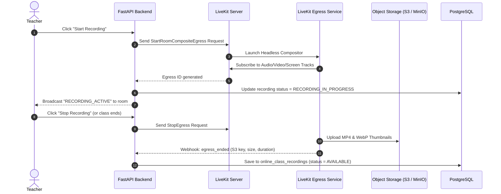

# Online Classroom: Security, Privacy & Recording Architecture

## 1. Security Architecture & Threat Modeling

### 1.1 Meeting Token Lifecycle & Ephemeral Grants
- **No Shared Passwords or Static Room Links**: Meeting URLs (`/online-classroom/[id]/live`) do not grant access alone. The client must call the backend with an active session cookie/bearer token to retrieve an ephemeral, signed room token.
- **Strict Role-Scoped Capabilities**:
  - **Teacher Token**: `canPublish: true`, `canPublishData: true`, `canSubscribe: true`, `hidden: false`, `roomAdmin: true`.
  - **Student Token**: `canPublish: true` (or `false` if teacher disabled mics/cams), `canPublishData: true` (chat/data), `canSubscribe: true`, `roomAdmin: false`.
  - **Admin Observer Token**: `canPublish: false`, `canSubscribe: true`, `hidden: false` (an explicit event is broadcast to all participants: `ADMIN_OBSERVER_JOINED`).
- **Token Expiry**: Generated tokens expire within 15 minutes if not connected; once connected, the LiveKit room session enforces the class duration cutoff.

### 1.2 Access Validation Guardrails
1. **Student Authorization Check**:
   - Query verifies the student's ID exists in `online_class_participants` where `status = 'ACTIVE'`.
   - Rejects with `403 Forbidden` if student is unassigned.
2. **Class Status & Timing Window**:
   - Students cannot join if the class status is `SCHEDULED` (and current time is before the allowed pre-join buffer, e.g. 10 minutes prior to start).
   - Rejects if status is `CANCELLED` or `COMPLETED`.

---

## 2. Server-Side Recording Pipeline (LiveKit Egress)

### 2.1 Why Server-Side Recording is Mandatory
- **Client-Side MediaRecorder Flaws**:
  - Drops recording if the teacher's browser crashes, closes, or experiences packet loss.
  - Consumes heavy CPU and upload bandwidth on the teacher's laptop.
  - Cannot capture remote participant streams without complex browser compositing.
- **Server-Side Compositing (LiveKit Egress)**:
  - Runs in a headless Chromium container on the media server cluster.
  - Composites the active room layout (presenter, video grid, whiteboard, and audio tracks) into a single 1080p MP4 file.
  - Directly streams the encoded MP4 into an S3/MinIO bucket.
  - Automatically captures thumbnail frames at 10-second intervals for the recording card preview.

---

## 3. Privacy, Consent & Retention Policies

### 3.1 Recording Consent & Indicators
- **Consent Gate**: When a student enters a room where recording is active or scheduled, a modal prompts: *"This class is being recorded for educational review. By continuing, you consent to being recorded."*
- **Persistent Visual Cue**: A high-visibility flashing red recording pill (`● REC`) is permanently visible in the top/bottom bar for all participants.
- **Audio Announcement**: System can optionally chime when recording starts or resumes.

### 3.2 Secure Playback & Access Protection
- **No Public S3 Buckets**: All recording buckets are strictly private with block-all public ACLs.
- **Pre-signed URLs**: Video playback URLs are generated dynamically on demand (`/recordings/{id}/stream`) with a 60-minute time-to-live (TTL).
- **Watermarking**: Video player embeds a subtle dynamic watermark with the viewer's student code and IP address to discourage screen capture leaks.

### 3.3 Storage Costs & Retention Enforcement
- **Storage Profile**:
  - 1080p 30fps H.264 video ~ 600 MB to 900 MB per hour.
  - S3 Standard: ~$0.023 per GB/month (approx. $0.02 per recorded class/month).
  - MinIO Self-hosted: Fixed disk storage costs.
- **Automated Retention Worker**:
  - Configurable retention window (e.g. 90 days or 1 academic year).
  - Soft-delete grace period (30 days in `ARCHIVED` status) before permanent purge, preventing accidental data loss.
