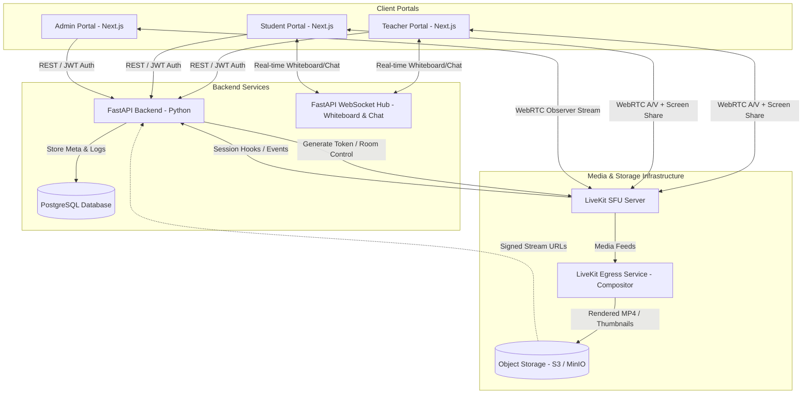

# Online Classroom: Technical Architecture & Video Engine Evaluation

## 1. Video Conferencing Technology Evaluation

To achieve a seamless, Google Meet-style virtual classroom experience, three primary architectural options have been evaluated against our strict module independence, security, embedding, and cost criteria.

### 1.1 Option Breakdown

#### Option A: Google Meet API & Workspace Integration
- **Architecture**: Uses Google Workspace REST APIs and Google Meet REST API to programmatically create Google Calendar events and Google Meet links (`meet.google.com/xxx-xxxx-xxx`).
- **User Experience**: Users are redirected out of the application to Google Meet in a new browser tab, or embedded via third-party iframe hacks (unsupported natively by Google).
- **Pros**:
  - Zero video hosting infrastructure needed.
  - Familiar Google Meet interface.
- **Cons & Blockers**:
  - **No In-App Embedding**: Google explicitly blocks embedding standard Meet calls inside iframe due to X-Frame-Options / CSP policies.
  - **Google Workspace Licensing**: Every teacher and student must have a licensed Google Workspace account.
  - **No Custom Whiteboard Integration**: Cannot embed our independent collaborative whiteboard directly into Google's UI.
  - **Recording Limitations**: Google Meet recording API requires Workspace Business Standard/Enterprise or Education Plus tiers and Google Drive authorization.
  - **Lack of Programmatic Admin Observer Controls**: No fine-grained programmatic observer modes or custom in-room telemetry.

#### Option B: Embedded Modern WebRTC SDK (LiveKit / Jitsi Meet)
- **Architecture**:
  - **LiveKit (Recommended)**: Open-source, production-grade WebRTC SFU (Selective Forwarding Unit) written in Go. Provides client SDKs for React/Next.js (`@livekit/components-react`, `livekit-client`) and server SDK for Python (`livekit-api`). Can be self-hosted via Docker or used via LiveKit Cloud.
  - **Jitsi Meet**: Open-source video conferencing suite. Can be embedded via Jitsi Meet IFrame API (`lib-jitsi-meet`).
- **User Experience**: Completely native, Google Meet-style UI embedded directly within the Next.js portal. Video tiles, chat, interactive whiteboard, and participant drawers live in the same React DOM tree.
- **Pros**:
  - **Complete UI/UX Control**: 100% custom Google Meet look-and-feel using MUI components.
  - **Rich Features**: Built-in screen sharing, simulcast, adaptive bitrate, active speaker detection, and audio level meters.
  - **Independent Token Auth**: Backend generates short-lived JWT tokens signed with our API key/secret, keeping authentication 100% independent.
  - **Server-Side Recording (Egress)**: LiveKit Egress composites composite room recordings (video, audio, whiteboard, screen share) directly to S3/MinIO/Cloud Storage without burdening the client.
  - **Transparent Observer Mode**: Administrators can join as hidden or explicit observers with audio/video publish disabled.
- **Cons**:
  - Requires SFU server infrastructure (either self-hosted LiveKit server or managed cloud).

#### Option C: Custom In-House WebRTC SFU & Signaling Stack
- **Architecture**: Building a custom signaling server with WebSockets, custom STUN/TURN (Coturn), and media server (Mediasoup or Pion).
- **User Experience**: Tailored embedded UI.
- **Pros**: Maximum architectural flexibility, zero third-party licensing.
- **Cons & Blockers**:
  - **Massive Engineering Overhead**: 3-6 months just to stabilize media renegotiation, ICE candidates, simulcast layer switching, and network degradation.
  - **High Maintenance**: Maintaining custom TURN/STUN relay routing and server-side media recording pipelines requires dedicated WebRTC devops engineers.

---

### 1.2 Technology Comparison Matrix

| Evaluation Criteria | Option A: Google Meet API | Option B1: LiveKit (Recommended) | Option B2: Jitsi Meet (Iframe) | Option C: Custom WebRTC SFU |
| :--- | :--- | :--- | :--- | :--- |
| **In-App Embedded Experience** | ❌ No (external tab redirect) | ✅ Full (native React components) | ⚠️ Partial (external iframe) | ✅ Full (native components) |
| **Google Meet Style & Layout** | External only | ✅ 100% customizable with MUI | ⚠️ Fixed Jitsi theme | ✅ Custom build |
| **Interactive Whiteboard Sync** | ❌ Separate external tab | ✅ Fully integrated in-room | ⚠️ Separate window | ✅ Integrated |
| **Screen Sharing Support** | ✅ Native in Meet | ✅ Native WebRTC Display Media | ✅ Native | ⚠️ Complex custom handling |
| **Server-Side Recording** | ❌ Google Drive / High Tier | ✅ LiveKit Egress to S3/MinIO | ⚠️ Jibri setup required | ❌ Very complex pipeline |
| **Participant Permissions (Mute/Kick)**| ⚠️ Google host only | ✅ Full API control via backend | ⚠️ Limited iframe events | ✅ Custom implementation |
| **Admin Observer Mode** | ❌ Not supported | ✅ Built-in permission flags | ⚠️ Difficult in iframe | ✅ Custom implementation |
| **Implementation Complexity** | Low (links only) | Moderate (SDK components) | Low-to-Moderate | Very High |
| **Hosting & Infrastructure** | Google cloud (paid licenses)| Self-hosted Docker or Cloud | Self-hosted or 8x8 Cloud | Heavy SFU clusters + Coturn |
| **Cost Profile** | $7 - $20/user/mo Google lic. | Open-Source Free / Low Cloud | Open-Source / 8x8 Cloud | Very High DevOps / bandwidth |
| **Long-Term Maintenance** | Low (Google managed) | Low (battle-tested open source)| Moderate | Very High |

---

## 2. Selected Architecture: LiveKit Embedded Architecture

### 2.1 Component Architecture Overview

### 2.2 Subsystem Breakdown
1. **FastAPI Application Layer**:
   - Manages online class lifecycles (create, update, cancel, complete).
   - Issues short-lived, cryptographically signed room access tokens using `livekit-api`.
   - Listens to LiveKit webhooks (`room_started`, `room_finished`, `participant_joined`, `participant_left`, `egress_ended`).
2. **Real-time Whiteboard & Presence Engine**:
   - WebSocket connection on `/api/v1/online-classes/{class_id}/ws`.
   - Broadcasts vector draw events, shapes, erase events, board clear commands, and participant hand raises with low latency.
3. **Media Engine (LiveKit SFU)**:
   - Handles WebRTC connection negotiation, peer connections, audio/video distribution, adaptive streaming, and screen-sharing tracks.
4. **Recording & Egress Service**:
   - Headless room compositor captures active speaker, screenshare, and whiteboard canvas into an MP4 file.
   - Uploads final MP4 and preview thumbnails to S3-compatible storage.
